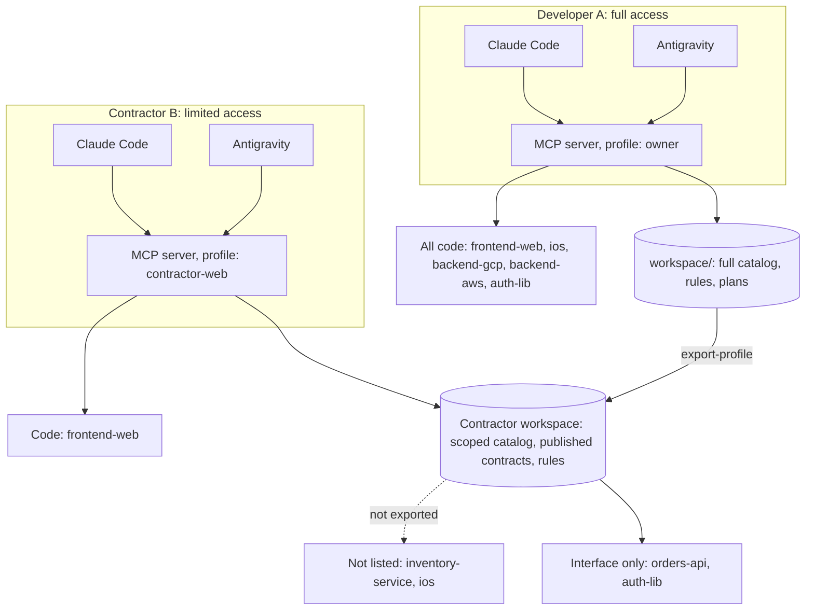

# 1context: one shared context across repos for AI code assistants

A working sample of a **local MCP server** that gives AI coding assistants (Claude Code, Google
Antigravity, or any MCP client) the same understanding of a system split across several repos: who
depends on what, what can be reused, the team's rules, and plans that one tool can start and another
can finish.

The system here is fictional: **Acme Retail, project1**. Each folder stands in for a separate Git repo.

```
1context-xrepo-mcp-codeassist/
├── project1/
│   ├── frontend-web/    web portal (JavaScript)            reads orders-api
│   ├── ios/             iOS package (Swift)                reads orders-api
│   ├── backend-gcp/     orders-api (Node, Cloud Run)       uses auth-lib, calls inventory-service
│   └── backend-aws/     inventory-service (Python, Lambda)
├── reusable/
│   └── auth-lib/        shared sign-in token helpers       used by orders-api
├── workspace/           shared context the server reads: repos, catalog, rules, learnings, plans
└── mcp-server/          the MCP server and its setup CLI
```

## The problem it solves

| What you need | Assistant alone (open folders) | With the MCP server | Tools the assistant calls |
|---|---|---|---|
| Know who a change affects | Nothing in `backend-gcp` says web and iOS read this response | The catalog lists every consumer before the edit | `get_service` |
| Reuse what already exists | Reads many files, or writes a new token check | Points to `auth-lib` and its package | `find_reuse` |
| Find code across repos | Opens whole files | `file:line` snippets and line ranges | `search_code`, `read_file` |
| Follow team rules and past decisions | Re-explained every session | Same rules and conventions in every tool | `workspace_overview`, `get_expert_pack`, `search_knowledge` |
| Change several repos together | One repo at a time; consumers break later | One plan, one branch, release order, checks per repo | `create_plan`, `workspace_status`, `run_check` |
| Switch tools mid-task | Chat history stays inside each tool | Plan checklist and progress log, tagged by tool | `list_plans`, `get_plan`, `update_plan` |
| Give a contractor limited access | All or nothing | Code for their repo, contracts for dependencies, nothing else listed | profiles + `export-profile` |
| Keep secrets out of AI context | Whatever is in the folder | Secret and state files never searched or served | built in |



## Quick start (about 5 minutes)

Requires Node 20+ and Git. Python 3 runs the AWS service's tests; Swift (macOS) runs the iOS tests.
ripgrep is optional but makes search faster.

```bash
git clone <this repo> && cd 1context-xrepo-mcp-codeassist
cd mcp-server && npm install && npm test && cd ..
node mcp-server/src/cli.js doctor --config workspace/workspace.yaml
```

### Connect Claude Code and Antigravity

```bash
node mcp-server/src/cli.js setup-tools --config workspace/workspace.yaml
```

This registers the server for Claude Code in each project folder (local scope), writes
`.agents/mcp_config.json` for Antigravity, and adds a short rules block to each folder's `AGENTS.md`
and `CLAUDE.md`. `setup-tools --remove` undoes all of it.

- **Claude Code** with every folder editable:
  `node mcp-server/src/cli.js claude --config workspace/workspace.yaml --repo orders-api`
- **Antigravity:** open `xrepo.code-workspace` (all folders in one window), then refresh MCP servers.

### Try it

Ask either assistant:

1. *"Add a `delivery_window` to orders. Check who consumes orders-api first, then create a plan."*
   It finds both consumers (web and iOS), plans contract → backend → clients on one branch, and runs
   each folder's tests.
2. *"I need to verify a sign-in token in a new service."* It points to `auth-lib` instead of writing a new one.
3. Stop halfway, switch tools, and ask *"Check list_plans and continue."*

### Limited access: contracts, not code

```bash
node mcp-server/src/cli.js export-profile --config workspace/workspace.yaml \
  --profile contractor-web --out exports/contractor-web
```

The export holds the contractor's repo (`frontend-web`), the published `orders-api` contract, the
`auth-lib` interface and the shared rules. Nothing in it mentions `inventory-service` or the iOS app,
and the command warns if a copied file still names a hidden repo. Clone `frontend-web` next to it as
`exports/repos/frontend-web` and point the contractor's tools at `exports/contractor-web/workspace.yaml`.

Git permissions remain the real security boundary: people only clone what they're allowed to. The
export decides what the assistant *knows about*.

## Run each project's tests

```bash
(cd project1/frontend-web && npm test)
(cd project1/backend-gcp  && npm test)
(cd reusable/auth-lib     && npm test)
(cd project1/backend-aws  && python3 -m unittest discover -s tests)
(cd project1/ios          && swift test)      # macOS
```

The assistant can run the same commands through `run_check`, which only runs checks declared in
`workspace/workspace.yaml`.

## Separate repos instead of folders

In a real system each project folder is its own Git repo. Only `workspace/workspace.yaml` changes: point
each `path` at your clone. Everything else (catalog, rules, plans, setup) works the same, and
`workspace_status` reports branch and changes per repo.

## Notes and limits

- The server informs; it doesn't enforce. Keep API contracts and CI checks.
- Search is text-based. Very large monorepos may want semantic indexing.
- Sharing between people is Git push/pull of the `workspace/` folder, not real time.
- `auth-lib` uses demo HMAC tokens so the sample runs offline. Real systems use their identity provider.
- The AWS and GCP deploy files are illustrative; nothing here deploys anything.
- Claude Code and Antigravity change over time; check their current MCP docs.

## License

MIT
